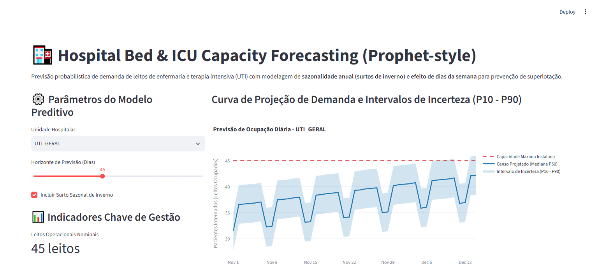

# 🏥 Hospital Bed & ICU Capacity Forecasting (Prophet-style)

[](https://www.python.org/downloads/)
[](#)
[](#)
[](#)
[](#)
[](#)

Pipeline de previsão de séries temporais probabilísticas para demanda de leitos hospitalares de enfermaria e UTI, modelando sazonalidade semanal (queda nos fins de semana) e sazonalidade anual (surtos de vírus respiratórios no inverno) com intervalos de incerteza (**P10/P50/P90**) para prevenção de superlotação (**Overflow Risk Management**).

---

## 📸 Validação Visual de Execução (Playwright E2E)

### Projeção Probabilística de Demanda e Limite de Capacidade Instalada


---

## 🎯 Por que Previsão Probabilística de Capacidade?

A superlotação de hospitais e unidades de emergência gera atrasos críticos em transferências de terapia intensiva e aumento na taxa de mortalidade.
Modelos determinísticos pontuais falham por não considerarem a incerteza estatística intrínseca das admissões de urgência.

Este projeto entrega:
1. **Modelagem Decomposta Aditiva**: Tendência + Efeito Dia da Semana + Surto Respiratório Sazonal.
2. **Intervalos Paramétricos P10 - P90**: Identificação preventiva de dias em que o limite de 90% da capacidade corre risco de ser violado.
3. **Plano de Ação Operacional**: Recomendações automáticas de escala de plantonistas e retaguarda clínica.

---

## 🏛️ Estrutura Arquitetural (CRISP-DM + SDD)

```
hospital-capacity-forecasting-prophet/
├── SPEC.md                           # Contratos Pydantic formais de entrada/saída
├── crisp_dm/
│   └── 01_business_understanding.md  # Fundamentação de gestão de operações hospitalares
├── src/
│   ├── schemas.py                    # Schemas Pydantic validados
│   ├── forecast_engine.py            # Motor de séries temporais e intervalos de incerteza
│   └── app.py                        # Interface analítica para diretoria clínica (Streamlit)
├── tests/
│   └── unit/
│       └── test_forecast.py          # Testes de limites e horizonte com PyTest
├── docs/
│   └── screenshots/                  # Evidências Playwright E2E
├── Dockerfile                        # Implantação em container
└── requirements.txt                  # Dependências fixadas
```

---

## 🧪 Parâmetros Operacionais por Unidade

| Unidade Hospitalar | Capacidade Nominal | Padrão Sazonal Crítico |
| :--- | :--- | :--- |
| **UTI Geral** | 45 leitos | Surto respiratório de inverno e choque séptico |
| **Enfermaria Clínica** | 120 leitos | Ciclos semanais (altas nas sextas-feiras) |
| **Pediatria** | 60 leitos | Pico agudo de bronquiolite (VSR) |
| **Emergência / Decúbito** | 80 leitos | Variação horária e feriados |

---

## 🚀 Como Executar Localmente

### 1. Clonar o repositório
```bash
git clone https://github.com/generozo-paulo/hospital-capacity-forecasting-prophet.git
cd hospital-capacity-forecasting-prophet
```

### 2. Instalar dependências
```bash
pip install -r requirements.txt
```

### 3. Rodar suíte de testes unitários
```bash
python -m pytest tests/unit/ -v
```

### 4. Executar Dashboard de Previsão
```bash
python -m streamlit run src/app.py
```
Acesse em: `http://localhost:8501`

---

## 🐳 Execução via Docker

```bash
docker build -t hospital-capacity-forecasting-prophet .
docker run -p 8501:8501 hospital-capacity-forecasting-prophet
```

---

## 👨‍💻 Autor

**Paulo Generozo**
- GitHub: [@generozo-paulo](https://github.com/generozo-paulo)
- Especialização: Time Series Forecasting, Operações Hospitalares & Data Science
